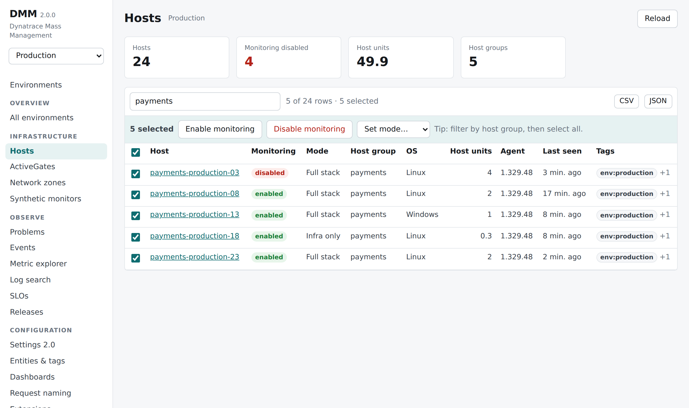
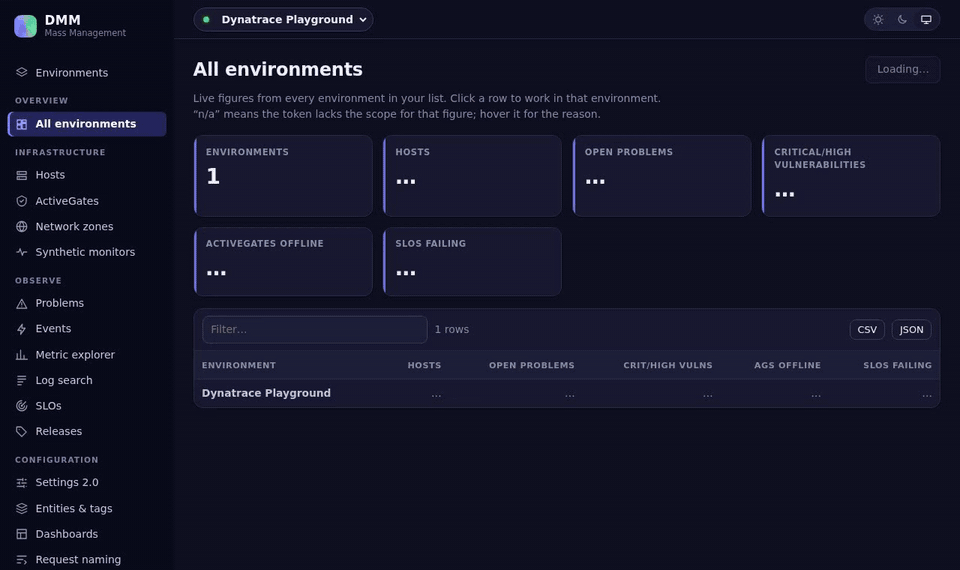

# DMM — Dynatrace Mass Management

Manage many Dynatrace environments from one browser tab. Nothing to install, no server: open the page, paste a token, go.

**[Open DMM →](https://hclivess.github.io/dynatrace-mass-management/)** · or try it with the built-in sample data, no Dynatrace account needed.





## What it does

1. **Every environment side by side.** Hosts, open problems, critical vulnerabilities, offline ActiveGates and failing SLOs across all your tenants, each figure fetched on its own so one missing scope costs one cell.
2. **Bulk changes the Dynatrace UI makes tedious.** Filter, select all, act:
   - enable or disable OneAgent monitoring, or switch monitoring mode, on hundreds of hosts in one batch;
   - add or remove tags on any entity selector;
   - close problems, mute vulnerabilities, enable or disable synthetic monitors, revoke API tokens.
3. **Copy configuration between environments.** Pick any Settings 2.0 schema (auto-tags, maintenance windows, management zones, alerting profiles, notifications, metric events, …), select objects, choose target environments. Each target validates first, existing names are skipped, and failures are reported per object.
4. **Export everything.** Every table exports to CSV or JSON; settings, dashboards and request naming rules export and import as JSON.
5. **Look around.** Metric explorer with charts, entity queries, events (and sending deployment events), logs, releases, SLOs, extensions, network zones, audit log.

All requests go **directly from your browser to Dynatrace**. There is no DMM server; the page is static files on GitHub Pages.

## Open it

- **Hosted:** <https://hclivess.github.io/dynatrace-mass-management/>
- **Offline / self-hosted:** download `dynatrace-mass-management-<version>-web.zip` from the [latest release](https://github.com/hclivess/dynatrace-mass-management/releases/latest), unzip, and serve the folder with any static web server (`npx serve`, `python -m http.server`, nginx, an internal share). Browsers do not run module scripts from `file://`, so double-clicking `index.html` is not enough.
- **From source:** `npm ci && npm run dev`

Then **Environments → Add environment**: the tenant ID or any URL you copy from Dynatrace, and a token.

| You paste | DMM calls |
|---|---|
| `abc12345` | `https://abc12345.live.dynatrace.com` |
| `https://abc12345.apps.dynatrace.com/ui/…` | `https://abc12345.live.dynatrace.com` |
| `https://dynatrace.example.com/e/<env-id>/#…` (Managed) | `https://dynatrace.example.com/e/<env-id>` |

## Tokens

Both kinds work:

- **Classic access token** (`dt0c01.…`), created under *Access tokens* in each environment. Include `apiTokens.read` and DMM shows which other scopes are missing.
- **Platform token** (`dt0s16.…`), created in Account Management. Dynatrace is moving everyone to these; their permissions come from the user or service user that owns them.

Scopes for a classic token, by page — give only what you use:

| Page | Read | Write |
|---|---|---|
| Overview, Hosts, Entities & tags | `entities.read`, `problems.read`, `securityProblems.read`, `activeGates.read`, `slo.read`, `oneAgents.read` | `entities.write` |
| Host monitoring, Settings 2.0 | `settings.read` | `settings.write` |
| Problems, Events | `problems.read`, `events.read` | `problems.write`, `events.ingest` |
| Metric explorer | `metrics.read` | |
| Vulnerabilities | `securityProblems.read` | `securityProblems.write` |
| SLOs | `slo.read` | `slo.write` |
| ActiveGates, Network zones | `activeGates.read`, `networkZones.read` | `networkZones.write` |
| Extensions | `extensions.read`, `extensionConfigurations.read` | `extensions.write` |
| Dashboards, Request naming | `ReadConfig` | `WriteConfig` |
| Synthetic monitors | `ReadSyntheticData` | `ExternalSyntheticIntegration` |
| Releases, Log search, Audit log | `releases.read`, `logs.read`, `auditLogs.read` | |
| API tokens | `apiTokens.read` | `apiTokens.write` |

## Where your tokens live

- By default, in this browser tab only (`sessionStorage`). Close the tab and they are gone.
- **Remember on this device** stores them in `localStorage`, encrypted with AES-256-GCM under a key derived from your passphrase (PBKDF2-SHA-256, 600,000 iterations, random salt). The passphrase is never stored. You are asked for it when you come back.
- **Export encrypted…** writes the same encrypted format to a file, to move your environment list to another machine. **Import…** also reads the `secrets.json` of DMM 1.x.
- The page's Content-Security-Policy allows scripts only from itself; it loads nothing from third parties. The only network requests are the Dynatrace API calls you trigger.

## What a browser cannot reach

Dynatrace only allows cross-site browser requests on the classic environment domain (`*.live.dynatrace.com`, Managed `/e/<id>`). These are blocked by Dynatrace's CORS policy, so DMM does not offer them:

- **Account Management** (users, groups, permissions; `api.dynatrace.com`, `sso.dynatrace.com`) — DMM 1.x had this through its Python server.
- **Platform APIs** on `*.apps.dynatrace.com`: Grail/DQL, new dashboards (Documents), the new SLO service, platform-token management.

Some classic APIs DMM uses are deprecated by Dynatrace but still work, and the page says so where it applies: log search and Extensions 2.0 (end of life end of 2027), classic API tokens, classic SLOs.

## Tips

| Symptom | What to do |
|---|---|
| "The token was rejected (401)" | Token expired, revoked, or pasted into the wrong environment. |
| "The token lacks a permission (403, …)" | Add the scope from the table above, or use *Test* on the Environments page to list what is missing. |
| "n/a" in the overview | Hover it: that figure needs a scope this token does not have. |
| "Cannot reach …" | The URL is wrong, a VPN is required, or a Managed cluster does not allow cross-site requests. Self-host DMM on the same domain as the cluster. |
| A copied setting fails in the target | It references an ID (management zone, alerting profile, entity) that only exists in the source. Copy the referenced object first, or fix the ID after copying. |
| Bulk host changes on thousands of hosts | Filter by host group first; writes go in batches of 100. |

## Build

```
npm ci
npm test            # unit tests: URL parsing, pagination, retries, errors, vault crypto
npm run build       # → dist/, static files
npx playwright install chromium
npm run e2e         # self-test: the built site against a mock Dynatrace (mock/), 26 scenarios
node scripts/screenshot.mjs   # docs/thumb.png and docs/demo.gif from a real run
```

`npm run mock` starts the mock on <http://localhost:8787/e/production> (also `staging`, `development`; token `dt0c01.MOCK…`). All its data is invented.

A tag `v*` runs the tests on Linux, Windows and macOS, the end-to-end self-test, attaches the zipped site with its `.sha256` to the GitHub release, and deploys GitHub Pages. The version lives only in `package.json`.

## Changes in 2.0.0

- **Rewritten as a static browser app** (TypeScript, Preact, Chart.js). Nothing to install: open the GitHub Pages URL, or unzip the release onto any web server. The Python/Tornado server of 1.x is gone. **Not compatible with 1.x**; your 1.x `secrets.json` can be imported once from the Environments page.
- **Current Dynatrace APIs.** Auto-tags, maintenance windows, management zones and host monitoring use Settings 2.0 instead of the deprecated Config API v1. Works with SaaS, the new platform URLs and Managed, with classic or platform tokens.
- **New:** overview across all environments, copy settings between environments (validated, skips duplicates), monitoring-mode switching, entity tagging by selector, vulnerabilities, network zone editing, synthetic monitor toggles, CSV/JSON export on every table, sample data to try it without Dynatrace.
- **Removed:** Account Management (users, groups, permissions). Dynatrace's Account Management API cannot be called from a browser.
- **Security:** tokens no longer sit in a plain JSON file next to a server. They stay in the browser, encrypted with your passphrase if you choose to keep them.

## License

MIT
